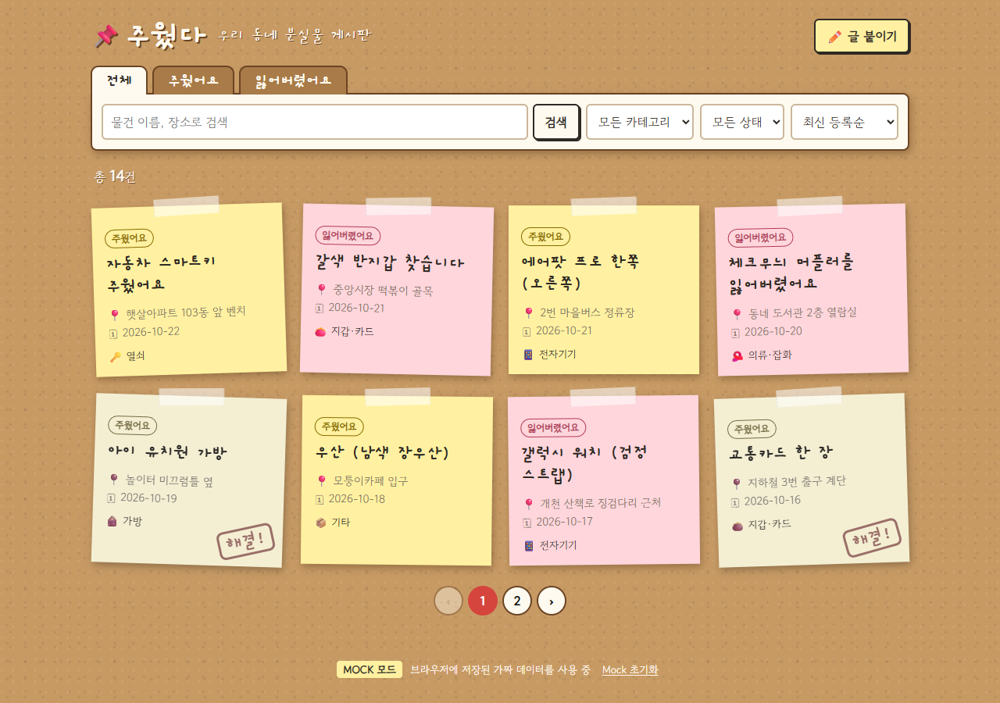
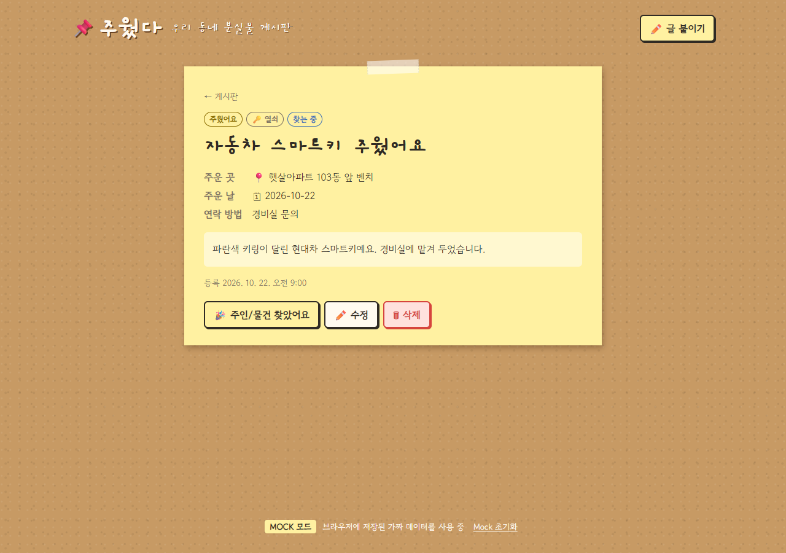
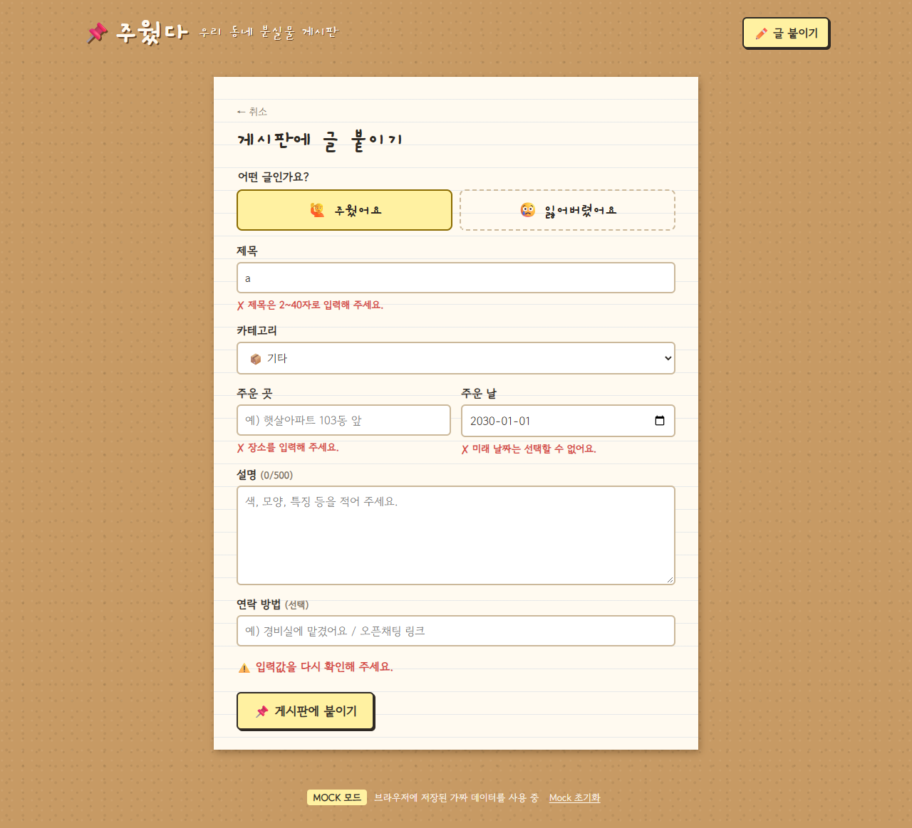
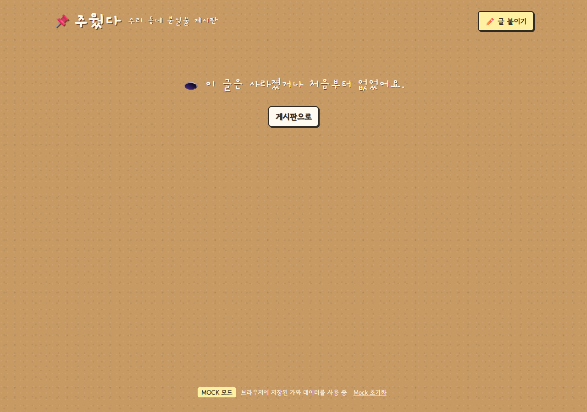
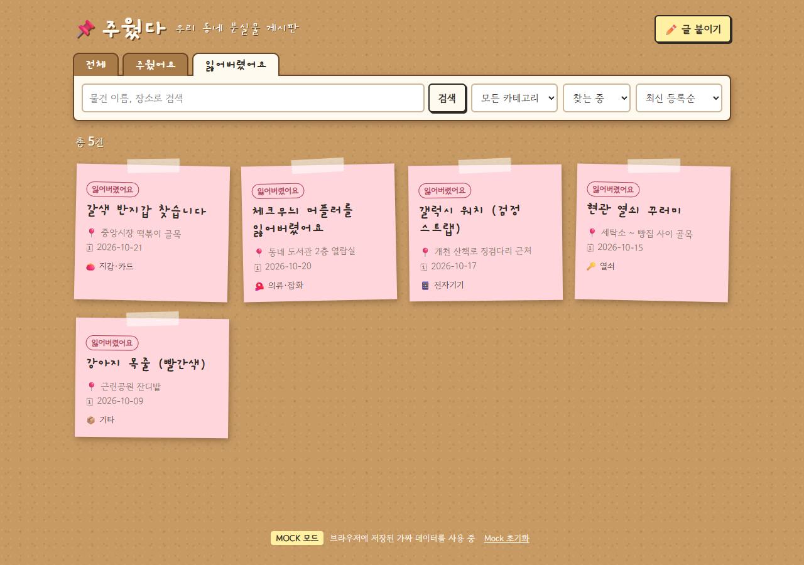
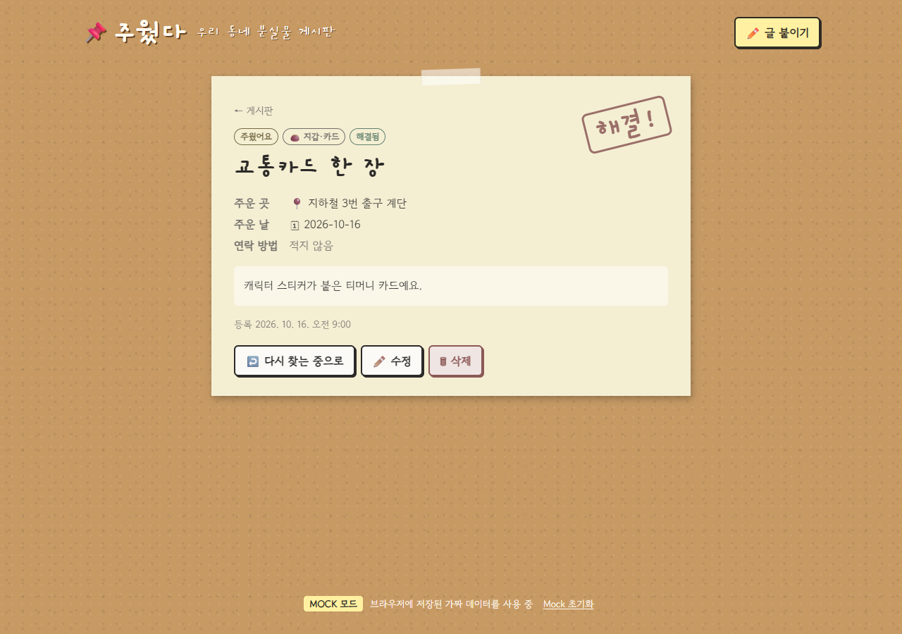
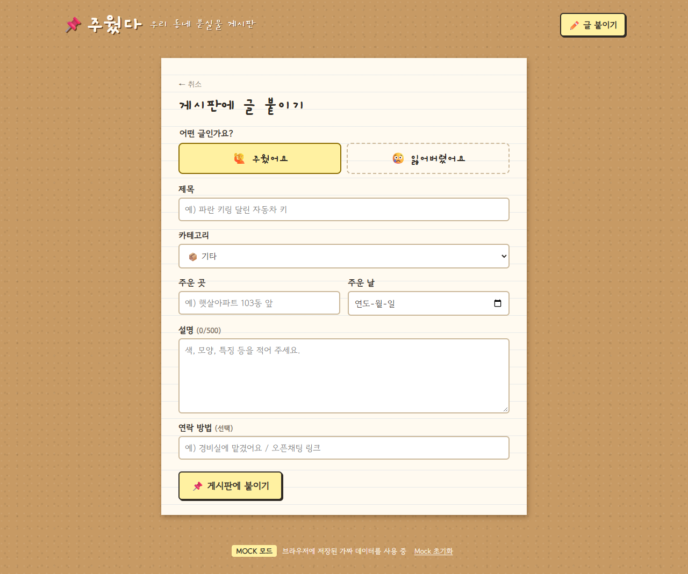
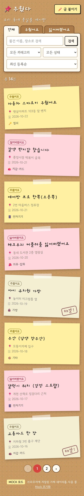

# 📌 주웠다 — 우리 동네 분실물 게시판

> **Week 1 · 핵심 학습: FastAPI 기초**
> CRUD · Pydantic 요청/응답 검증 · Path / Query 파라미터 · HTTP 상태 코드와 에러 응답

## 서비스 소개

아파트 단지 게시판에 붙어 있던 "열쇠 주우신 분~" 쪽지를 웹으로 옮긴 서비스입니다.
동네에서 **물건을 주운 사람**은 "주웠어요" 쪽지를, **물건을 잃어버린 사람**은 "잃어버렸어요" 쪽지를 코르크 게시판에 붙입니다.
물건이 주인을 찾으면 쪽지에 **"해결!" 도장**이 찍힙니다.

로그인 없이 누구나 글을 쓰고 고칠 수 있는 동네 게시판입니다. (인증은 이번 주 범위가 아닙니다.)

### 화면 한눈에 보기

| 게시판 (목록) | 글 상세 |
| --- | --- |
|  |  |
| **글 쓰기 — 검증 에러** | **없는 글 (404)** |
|  |  |

### 디자인 컨셉

- **코르크 게시판 + 포스트잇**: 배경은 코르크 질감, 글 하나하나는 마스킹 테이프로 붙인 쪽지입니다. 쪽지는 살짝씩 기울어져 있어 손으로 붙인 느낌을 줍니다.
- **색으로 종류 구분**: 🟨 노랑 = 주웠어요, 🟥 분홍 = 잃어버렸어요. 해결된 글은 색이 바래고 빨간 **"해결!" 도장**이 찍힙니다.
- **손글씨 폰트**: 로고 · 제목 · 탭에 손글씨체를 써서 동네 게시판 쪽지 분위기를 냅니다.
- **반응형**: 데스크톱에서는 한 줄에 쪽지 4장, 모바일에서는 1장씩 세로로 쌓입니다. (아래 [모바일 화면](#4-모바일-화면) 참고)

### 기술 스택

| 구분 | 사용 기술 |
| --- | --- |
| 프론트엔드 | React 18 · TypeScript · Vite 5 · React Router 6 |
| 백엔드 (이번 주 과제) | FastAPI · Pydantic |
| 데이터 (서버 연결 전) | 브라우저 `localStorage` 기반 Mock 저장소 (지연 350ms, 404 · 422 흉내) |

### 폴더 구조

```
1_주웠다_FastAPI/
├── backend/                 # FastAPI 서버 (직접 구현)
│   └── app/
│       ├── main.py
│       ├── core/config.py
│       └── modules/
├── frontend/
│   └── src/
│       ├── api/
│       │   ├── client.ts    # fetch 래퍼 · ApiError 변환
│       │   └── posts.ts     # ⭐ 백엔드 연결 지점 (함수 6개)
│       ├── mock/            # Mock 저장소 · 시드 데이터 14건
│       ├── pages/           # ListPage · DetailPage · FormPage
│       ├── components/      # PostCard · Pagination · ErrorBox
│       ├── types.ts         # Post · PostInput · PostPage 타입
│       └── labels.ts        # 종류 · 카테고리 · 상태 한글 라벨
└── docs/screenshots/        # README 스크린샷
```

---

## 실행 방법

```bash
cd frontend
npm install
npm run dev      # http://localhost:5173
```

| 환경 변수 | 기본값 | 설명 |
| --- | --- | --- |
| `VITE_USE_MOCK` | `true` | `false` 로 바꾸면 Mock 대신 실제 서버를 호출합니다 |
| `VITE_API_BASE_URL` | `http://localhost:8000` | FastAPI 서버 주소 |

`frontend/.env.example` 을 `frontend/.env` 로 복사해 값을 바꾸세요.
화면 맨 아래 푸터에 지금 **MOCK 모드**인지 **API 모드**인지 표시됩니다.

> 브라우저(5173)와 서버(8000)의 포트가 달라서 서버에서 **CORS** 를 허용해야 합니다.

---

## 사용자 관점 기능 목록

| # | 기능 | 사용자가 하는 일 |
| --- | --- | --- |
| 1 | 글 목록 보기 | 게시판에 붙은 쪽지들을 한눈에 본다 |
| 2 | 종류로 보기 | "전체 / 주웠어요 / 잃어버렸어요" 탭을 누른다 |
| 3 | 검색 | 물건 이름이나 장소로 검색한다 (제목 · 설명 · 장소) |
| 4 | 카테고리 필터 | 전자기기, 지갑·카드, 열쇠, 가방, 의류·잡화, 기타 중 하나만 본다 |
| 5 | 상태 필터 | "찾는 중"인 글만, 또는 "해결됨"인 글만 본다 |
| 6 | 정렬 | 최신 등록순 / 오래된 등록순으로 바꾼다 |
| 7 | 페이지 이동 | 한 페이지에 8개씩, 아래 번호를 눌러 넘긴다 |
| 8 | 글 상세 보기 | 쪽지를 눌러 장소 · 날짜 · 연락 방법 · 설명을 본다 |
| 9 | 글 쓰기 | 종류, 제목, 카테고리, 장소, 날짜, 설명, 연락 방법(선택)을 적어 붙인다 |
| 10 | 글 고치기 | 이미 붙인 글의 내용을 전부 고친다 |
| 11 | 해결 처리 | "주인/물건 찾았어요" 버튼으로 해결 도장을 찍는다 (되돌리기 가능) |
| 12 | 글 떼기 | 삭제 버튼 → 확인 후 게시판에서 없앤다 |

### 입력 규칙 (서버가 검증해야 하는 것)

화면은 **일부러 입력값을 검사하지 않습니다.** 잘못된 값도 그대로 서버에 보내고,
서버가 돌려준 검증 에러를 입력칸 아래에 빨간 글씨로 보여 줍니다. Mock 은 아래 규칙으로 검증합니다.

| 항목 | 규칙 |
| --- | --- |
| 종류 | 주웠어요 / 잃어버렸어요 중 하나 (필수) |
| 제목 | 앞뒤 공백 제외 2~40자 (필수) |
| 카테고리 | 6개 중 하나 (필수) |
| 장소 | 1~50자 (필수) |
| 날짜 | 날짜 형식, **오늘 이후 날짜 불가** (필수) |
| 설명 | 0~500자 |
| 연락 방법 | 0~50자, 비우면 "없음" |
| 상태 | 새 글은 항상 "찾는 중"으로 시작. 등록 · 수정 폼에서는 바꿀 수 없음 |

> 💡 Mock 을 끄고 서버를 붙였을 때, 제목에 한 글자만 넣고 등록해 보세요.
> 서버가 막아 주면 입력칸 아래에 에러가 뜹니다. 아무 일 없이 등록된다면 검증이 빠진 것입니다.

---

## 화면별 동작 설명

### 1. 게시판 (목록) — `/`


- 상단 **탭**(전체 / 주웠어요 / 잃어버렸어요) 아래에 검색창과 카테고리 · 상태 · 정렬 드롭다운이 있습니다.
- "총 N건" 아래로 쪽지가 한 페이지에 8장씩 붙고, 맨 아래에 페이지 번호가 있습니다.
- 푸터의 **MOCK 모드** 배지로 지금 가짜 데이터를 쓰는 중인지 알 수 있고, "Mock 초기화"로 시드 데이터로 되돌릴 수 있습니다.

필터를 건 모습 — "잃어버렸어요" 탭 + "찾는 중" 상태 (`/?type=LOST&status=OPEN`):



- 들어오면 조건에 맞는 글 목록을 불러옵니다. 불러오는 동안에는 "불러오는 중…"이 보입니다.
- **탭 · 검색 · 카테고리 · 상태 · 정렬**을 바꾸면 목록을 다시 불러오고, **1페이지로 돌아갑니다.**
- 검색은 입력 후 Enter 또는 "검색" 버튼을 눌렀을 때만 실행됩니다. 검색어를 지우고 검색하면 조건이 풀립니다.
- 모든 조건은 주소창 쿼리에 남습니다. (예: `/?type=LOST&category=KEY&page=2`)
  새로고침, 뒤로 가기, 링크 공유를 해도 같은 목록이 보입니다.
- 상단에 **조건에 맞는 전체 개수**를 보여 주고, 하단에 **전체 페이지 수**만큼 번호를 보여 줍니다.
  → 목록 응답에는 이번 페이지의 글뿐 아니라 **전체 개수**도 있어야 합니다.
- 쪽지 색: 노랑 = 주웠어요, 분홍 = 잃어버렸어요. 해결된 글은 색이 바래고 "해결!" 도장이 찍힙니다.
- 결과가 없으면 "조건에 맞는 글이 없어요"를 보여 줍니다.
- 서버 오류가 나면 상태 코드와 메시지, "다시 시도" 버튼을 보여 줍니다.

### 2. 글 상세 — `/posts/{id}`

| 찾는 중인 글 | 해결된 글 |
| --- | --- |
|  |  |

- 종류 · 카테고리 · 상태 배지, 제목, 장소 · 날짜 · 연락 방법, 설명, 등록 시각이 한 장의 쪽지에 담깁니다.
- 라벨은 종류에 따라 "주운 곳 / 주운 날" 또는 "잃어버린 곳 / 잃어버린 날"로 바뀝니다. 연락 방법이 없으면 "적지 않음"으로 표시됩니다.
- 해결된 글은 쪽지 색이 바래고 오른쪽 위에 **"해결!" 도장**이 찍히며, 첫 버튼이 "다시 찾는 중으로"로 바뀝니다.

없는 글로 들어온 경우 (`/posts/9999`):


- 주소의 id로 글 하나를 불러옵니다.
- **없는 id**(예: `/posts/9999`)로 들어오면 서버가 **404**를 돌려줘야 하고, 화면은 "이 글은 사라졌거나 처음부터 없었어요"를 보여 줍니다.
- 등록 시각을 보여 주고, 수정된 적이 있으면 수정 시각도 함께 보여 줍니다. → 서버가 두 시각을 관리해야 합니다.
- **🎉 주인/물건 찾았어요**: 상태만 "해결됨"으로 바꿉니다. 다른 내용은 그대로입니다.
  해결된 글에서는 **↩️ 다시 찾는 중으로** 버튼으로 되돌릴 수 있습니다. 서버가 돌려준 글로 화면을 바로 갱신합니다.
- **✏️ 수정**: 수정 화면으로 이동합니다.
- **🗑 삭제**: 확인 창 → 삭제 성공 시 게시판으로 이동합니다. 삭제 응답 본문은 필요 없습니다.
- 버튼 동작이 실패하면 버튼 위에 에러를 보여 줍니다. (예: 다른 탭에서 이미 삭제한 글 → 404)

### 3. 글 쓰기 — `/posts/new` · 글 고치기 — `/posts/{id}/edit`

| 빈 폼 | 검증 실패 (422) |
| --- | --- |
|  |  |

- 맨 위 **"어떤 글인가요?"** 에서 🙋 주웠어요 / 😢 잃어버렸어요 중 하나를 고릅니다.
- 오른쪽 스크린샷은 제목에 `a` 한 글자, 장소는 비우고, 날짜는 `2030-01-01`(미래)로 제출한 결과입니다.
  각 입력칸 아래에 서버(Mock)가 돌려준 메시지가, 제출 버튼 위에 "입력값을 다시 확인해 주세요." 요약이 표시됩니다.

- 같은 폼을 함께 씁니다. 수정일 때는 먼저 기존 글을 불러와 폼을 채웁니다. (없는 id면 404 화면)
- 종류를 바꾸면 라벨이 "주운 곳 / 잃어버린 곳", "주운 날 / 잃어버린 날"로 바뀝니다.
- 수정은 **모든 항목을 한 번에** 보냅니다. (일부 항목만 보내지 않습니다)
- 제출 성공 → 서버가 돌려준 글의 **id**로 상세 화면으로 이동합니다. → 등록 응답에 새 글의 id가 있어야 합니다.
- 검증 실패(**422**) → 필드별 메시지를 각 입력칸 아래에, 폼 아래에 요약 메시지를 보여 줍니다.
  FastAPI 기본 검증 에러 형식(`detail` 배열의 `loc` 마지막 값 = 필드 이름)을 그대로 이해합니다.
  필드 이름은 `title`, `description`, `category`, `place`, `date`, `contact`, `type` 입니다.
- 그 밖의 실패 → 상태 코드와 메시지를 폼 아래에 보여 줍니다.

### 4. 모바일 화면



- 화면 폭이 좁으면 검색창 · 드롭다운이 여러 줄로 나뉘고, 쪽지는 한 줄에 한 장씩 쌓입니다.

---

## 백엔드 연결 지점

화면은 [`frontend/src/api/posts.ts`](frontend/src/api/posts.ts) 의 함수 6개만 호출합니다.
각 함수의 `TODO(백엔드 연결)` 부분을 채우면 됩니다. **URL, HTTP 메서드, 요청/응답 형식은 직접 설계하세요.**

| 함수 | 쓰는 화면 | 받는 값 | 돌려줘야 하는 값 |
| --- | --- | --- | --- |
| `fetchPosts(query)` | 게시판 | 검색어 · 종류 · 카테고리 · 상태 · 정렬 · 페이지 · 페이지 크기 | `PostPage` (글 목록 + 전체 개수 + 페이지 정보) |
| `fetchPost(id)` | 상세, 수정 | 글 id | `Post` / 없으면 404 |
| `createPost(input)` | 글 쓰기 | `PostInput` | 등록된 `Post` |
| `updatePost(id, input)` | 글 고치기 | 글 id, `PostInput` | 수정된 `Post` |
| `changePostStatus(id, status)` | 상세 | 글 id, `OPEN` / `RESOLVED` | 바뀐 `Post` |
| `deletePost(id)` | 상세 | 글 id | 없음 |

- 화면용 타입은 [`frontend/src/types.ts`](frontend/src/types.ts) 에 있습니다. 서버 응답 모양이 다르면 (예: `snake_case`) `posts.ts` 에서 변환해 주세요.
- [`frontend/src/api/client.ts`](frontend/src/api/client.ts) 의 `request()` 를 쓰면 에러 응답이 자동으로 `ApiError` 로 바뀝니다.
  - `{"detail": "..."}` → 메시지 표시
  - `{"detail": [{"loc": [..., "title"], "msg": "..."}]}` → `title` 입력칸 아래에 표시
  - 204 응답 → `undefined`
- Mock 구현은 [`frontend/src/mock/store.ts`](frontend/src/mock/store.ts) 에 있습니다. 서버 동작을 만들 때 참고용 "기대 동작"으로 보세요.

## 이번 주 체크리스트

- [ ] 서버를 띄우고 CORS 허용
- [ ] `fetchPosts` 연결: 필터 · 검색 · 정렬 · 페이지가 모두 동작
- [ ] `fetchPost` 연결: 없는 id → 404 화면
- [ ] `createPost` 연결: 잘못된 입력 → 입력칸 아래 에러, 미래 날짜 거부
- [ ] `updatePost` · `changePostStatus` · `deletePost` 연결
- [ ] `VITE_USE_MOCK=false` 상태로 위 화면 동작을 전부 다시 확인
